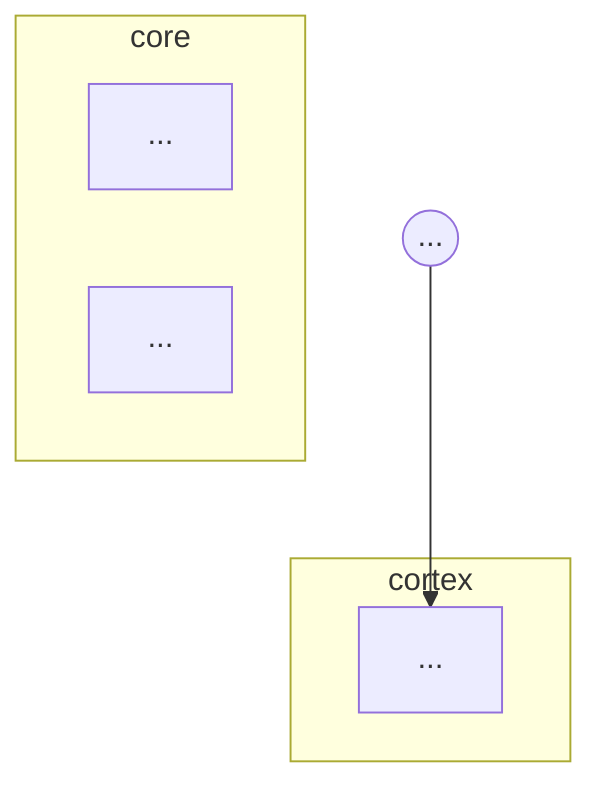

# Design — topology property checking

## 1. The model

Let `G = (V, E)` be the layer DAG of one `Architecture`:

- `V` = `{ly.name for ly in arch.layers}`
- `E` = `{(e.source, e.target) for e in arch.flow}` — a **set**; parallel flow
  rows between the same pair (legal, e.g. two tensors along the same edge)
  collapse for reachability purposes.

Stage 2 has already proved `G` acyclic and every name resolvable by the time
Stage 6 runs, so every algorithm below terminates without a visited-guard
argument beyond the usual BFS one.

### 1.1 Why there is no guard overapproximation here

`orca-lang`'s design devotes a section (2.4) to the fact that its checks ignore
transition guards, making `reachable` an overapproximation and `unreachable`
conservative. **That entire concern is absent in n-orca.** A `## flow` edge is
unconditional: if the edge is in the table, the tensor flows along it on every
forward pass. So:

| Property | `orca-lang` | n-orca |
|----------|-------------|--------|
| `reachable` | over-approximate (guards may block) | **exact** |
| `unreachable` | conservative — false positives possible | **exact** |
| `passes_through` | conservative — false negatives possible | **exact** |
| `within` (`responds`) | over-approximate | **exact** |

Consequence for error messages: n-orca must **not** copy `orca-lang`'s
disclaimer *"This check ignores guard conditions."* It would be false. A
counterexample path in n-orca is a real gradient/activation path.

This is the single most important semantic difference between the two ports and
the reason the counterexample is worth printing: it is a fact about the model,
not a hypothesis.

## 2. Groups

```markdown
## groups

| Name   | Layers                                                  |
|--------|---------------------------------------------------------|
| core   | core_sense, core_fc, core_add, core_act, affect_head     |
| cortex | embed, attn_norm, attn, add_attn, ff, add_ff, cortex_ln  |
```

- Parsed exactly like `## tensors` — a markdown table, header dropped.
- `Layers` is a comma-separated list of declared layer names. Order is
  preserved (it is the order used when a message has to enumerate members) but
  is not semantically meaningful.
- A group is a **set of layers**, nothing more. It is not a subgraph, not a
  module, not a namespace. It has no shape and contributes no parameters of its
  own.
- Groups may overlap. Overlap is a `GROUP_OVERLAP` **warning**, not an error:
  it is legal, but it almost always means the boundary the author is asserting
  is not the one they think they are asserting. (If `bus ⊂ cortex`, then
  `unreachable: core from cortex` is asserting something about the bus too.)
- A group name equal to a layer name is `GROUP_NAME_COLLISION`, an **error**.
  Property operands are resolved in one namespace; a collision would make
  `unreachable: x from y` ambiguous, and silently picking one would be the
  worst possible outcome for a checker whose whole value is that you can trust
  its answer.
- A group naming an undeclared layer is `PROPERTY_UNKNOWN_REFERENCE` (same
  code as a property naming an undeclared layer — one code for one meaning:
  "this document refers to something that does not exist").
- An empty group is legal but degenerate; see §4.6.

### 2.1 Resolution

`resolve(name) -> list[str] | None`

1. If `name` is a group name, return its member layers.
2. Else if `name` is a layer name, return `[name]`.
3. Else `None` → `PROPERTY_UNKNOWN_REFERENCE`.

Groups are checked first. Because `GROUP_NAME_COLLISION` is an error, the two
branches are provably disjoint on any document that gets past group
validation; the ordering is defensive, not meaningful.

## 3. Properties

```markdown
## properties
- reachable: v_hat from obs
- unreachable: core from cortex
- passes_through: bus for core -> cortex
- within: y from obs <= 12
- param_fraction: core <= 1%
- out_dim: nm_bus <= n_affect
```

One bullet per property, `kind: operands`. A bullet that does not match its
kind's grammar is `PROPERTY_MALFORMED`; an unrecognized kind is also
`PROPERTY_MALFORMED` (not silently ignored — silence is how
`## verification rules` became decorative).

| Kind | Syntax | Meaning | Method |
|------|--------|---------|--------|
| `reachable` | `reachable: B from A` | ∃ path A→B | BFS from A |
| `unreachable` | `unreachable: B from A` | ¬∃ path A→B | BFS from A, assert B unvisited |
| `passes_through` | `passes_through: C for A -> B` | every A→B path visits C | delete C, assert B unreachable from A |
| `within` | `within: B from A <= N` | B reachable from A in ≤ N edges | shortest-path BFS, compared to N |
| `param_fraction` | `param_fraction: G <= P%` | G's params ≤ P% of total | Σ group params / `report.param_count` |
| `out_dim` | `out_dim: L <= <expr>` | L's inferred last dim ≤ expr | `report.inferred_shapes[L][-1]` vs resolved expr |

### 3.1 `within` is the rename of `orca-lang`'s `responds`

`orca-lang` calls this `responds: B from A within N` and the name is right
there: in a state machine, N counts *transitions*, i.e. events the machine must
respond to, and the property is a **liveness/latency** claim — "the system
responds within N steps".

In a layer DAG there are no events and nothing responds. N counts **edges**,
and the claim is about *depth* — how many ops of compute and how many
gradient-multiplication steps separate two layers. Keeping the name `responds`
would import a temporal reading into a structure that has no time in it, and
would invite the wrong intuition on `param_fraction`-style follow-ups.

So the property is spelled `within`, which was already the `orca-lang` keyword
carrying the bound, and the surface syntax moves the bound to the end with an
explicit comparison operator (`<= N`) to line up with `param_fraction` and
`out_dim`, both of which are bounds too:

```
responds: settled from idle within 5     # orca-lang
within:   y       from obs  <= 12        # n-orca
```

This is the only rename in the port. `reachable`, `unreachable`,
`passes_through` and every error code keep their `orca-lang` spelling
verbatim, per the "stay a family" constraint.

## 4. Formal semantics

Throughout, `A* = resolve(A)`, `B* = resolve(B)`, `C* = resolve(C)`, each a set
of layers. `path(a, b)` means "there exists a directed path from `a` to `b` in
`G`". Reflexivity: a layer reaches itself by the empty path, so
`path(a, a)` is **true** and `dist(a, a) = 0`. This matters when a single layer
appears in both operands (see §4.6).

### 4.1 `reachable: B from A`

> **∃**a ∈ A*, **∃**b ∈ B* : path(a, b)

Existential in both operands. Reading: *"the group A can influence the group
B"*. One witnessing pair is enough — the claim is that influence is possible,
and one live wire makes it possible.

Fails with `PROPERTY_REACHABILITY_FAIL`.

### 4.2 `unreachable: B from A`

> **∀**a ∈ A*, **∀**b ∈ B* : ¬path(a, b)

Universal in both operands — this is exactly `¬(4.1)`, which is the point: the
two properties are complements, so an author can never have both hold or both
fail. Reading: *"nothing in A can influence anything in B"*.

Spelled out for the canonical case, because this is the sentence that gets
mis-refactored: `unreachable: core from cortex` holds **iff for every layer
`a ∈ cortex` and every layer `b ∈ core` there is no path `a → b`**. It is not
"no path from the cortex group considered as a node", and it is not "some
cortex layer cannot reach some core layer".

**The relation is directed and the property is asymmetric.** On the canonical
example, `unreachable: core from cortex` holds while
`unreachable: cortex from core` does *not* — the neuromodulator bus carries
core → cortex by design. Both are meaningful claims and they are not each
other's restatement. `from` always names the **source**.

Fails with `PROPERTY_EXCLUSION_FAIL`, message carrying the first witnessing
path found (§5).

### 4.3 `passes_through: C for A -> B`

Let `G' = G` with **every layer in `C*`** and all their incident edges deleted.

> **∀**a ∈ A*, **∀**b ∈ B* : ¬path\_{G'}(a, b)

Reading: *"every route from A to B goes through C"* — `C*` is a **cut set**
(not necessarily a cut vertex; with a group it is a set) separating `A*` from
`B*`.

Spelled out, because this is the other sentence that gets mis-refactored:
deleting **all** of `C`'s layers must make **every** `b ∈ B*` unreachable from
**every** `a ∈ A*`. Deleting them one at a time is a different and weaker
check, and would pass on a redundant two-lane bus that the author intended to
treat as one boundary.

Any `a ∈ A* ∩ C*` or `b ∈ B* ∩ C*` is deleted along with the rest of `C*` and
so trivially cannot be an endpoint in `G'`; this is consistent with the
reading ("the route is through C") and is one of the reasons `GROUP_OVERLAP`
is warned about.

Vacuous truth is accepted: if `B*` is already unreachable from `A*` in `G`, the
property holds. Reporting a failure there would be wrong — every A→B path does
visit C, there being none.

Fails with `PROPERTY_PATH_FAIL`, message carrying the bypassing path found in
`G'` (§5).

### 4.4 `within: B from A <= N`

Let `dist(a, b)` be the shortest-path edge count.

> **∃**a ∈ A*, **∃**b ∈ B* : dist(a, b) ≤ N

Existential, matching `reachable` (`within` is `reachable` plus a budget), and
implemented as a BFS from all of `A*` seeded at depth 0 — a multi-source BFS
computes `min over a of dist(a, b)` in one pass.

The BFS is **unbounded**, with `N` applied as a comparison afterwards, rather
than capped at depth `N`. Both are O(V+E), but the failure message has to report
the *actual* shortest distance to be actionable ("shortest path is 17 edges" is
a fix; "not within 4" is not), and a capped search cannot know it.

`N` must parse as a non-negative integer; otherwise `PROPERTY_MALFORMED`.

Fails with `PROPERTY_DEPTH_FAIL`. The message distinguishes the two failure
modes, because the fixes are opposite:

- reachable but too far → report the actual shortest distance ("shortest path
  is 17 edges");
- not reachable at all → say so ("no path exists"), since raising `N` will
  never help.

### 4.5 `param_fraction: G <= P%` and `out_dim: L <= <expr>`

These two are DAG-native — `orca-lang` has no analogue, because a state has no
width and a machine has no parameters. Both are *quantitative* claims about a
named part of the graph, and both are the natural companions of the topological
ones: a frozen value core is only meaningfully "small and isolated" if you can
assert both halves.

**`param_fraction: G <= P%`.** `G` may be a group or a single layer.
Per-layer parameter counts are recomputed with the same
`spec.params(resolved_args, in_shapes)` call Stage 4 uses, over the same
hyperparameter substitution map, so the numerator and `report.param_count`
(the denominator) are computed by one code path and cannot drift. If
`report.param_count == 0` the check is skipped (no denominator; nothing to
claim). `P` is a percentage and may be fractional (`0.5%`); the `%` is
required, since `param_fraction: core <= 1` would be ambiguous between "1%"
and "1 param".

The message reports the fraction as a percentage **and** the raw counts, since
"1.34% (45,312 of 3,390,657)" tells the author which lever to pull and a bare
percentage does not.

**`out_dim: L <= <expr>`.** `L` must be a **single layer**, not a group: a
group has no output width. Naming a group here is `PROPERTY_MALFORMED` rather
than `PROPERTY_UNKNOWN_REFERENCE` — the name resolved fine, the property is
the wrong shape for it.

The left side is `report.inferred_shapes[L][-1]`. If `L` has no inferred shape
(Stage 3 gave up upstream) the check is skipped silently — Stage 3 already
emitted the explanation and a second error about a consequence of it is noise.

The right side goes through **`_resolve_arg(expr, hp_subs)`** from
`verifier.py` — the exact function Stage 4 uses for op args. That buys
hyperparameter substitution (`n_affect` → `8`) and guarded arithmetic
(`d_model * 4`) with no second expression evaluator to keep in sync. Both
sides must resolve to integers after substitution; if either is still symbolic
(e.g. a free `B`/`S`) the check is skipped silently, because n-orca
deliberately treats those as opaque and an unresolvable comparison is not a
violation.

Fails with `PROPERTY_WIDTH_FAIL`.

### 4.6 Degenerate operands

Made explicit so a later refactor does not "fix" them:

| Case | Behaviour | Reason |
|------|-----------|--------|
| `A*` or `B*` empty (empty group) | `reachable`/`within` **fail**; `unreachable`/`passes_through` **hold** | Vacuous quantification. `∃` over ∅ is false, `∀` over ∅ is true. The empty group is the author's mistake, and `GROUP_OVERLAP`/`PROPERTY_UNKNOWN_REFERENCE` will usually have already said so. |
| `A* ∩ B* ≠ ∅` | `unreachable` fails on the shared layer (path of length 0) | Reflexivity. A layer can influence itself. Reporting it is more useful than special-casing it away, because it means the two groups the author is separating are not disjoint. |
| `A == B` (same operand twice) | `reachable` holds, `unreachable` fails | Same reason. |

## 5. Counterexamples

For `PROPERTY_EXCLUSION_FAIL` and `PROPERTY_PATH_FAIL` the message **must**
contain the violating path, formatted as an arrow chain with `" -> "`:

```
cortex_ln -> critic_fc -> feedback_proj -> core_add
```

This matches `orca-lang`'s counterexample format minus the `[event]`
annotations, which have no DAG analogue (an edge's tensor name is not an
event and is not what makes the edge exist).

Extraction: BFS maintains `parent: dict[str, str]`; on hitting a target, walk
`parent` back to the source and reverse. BFS (not DFS) so the reported path is
a **shortest** witness — the shortest leak is the most legible one and the one
whose removal is least ambiguous.

Determinism is required, since the path goes into an error message that tests
and CI diff. Adjacency lists are built in `arch.flow` **row order** and the BFS
frontier is a FIFO queue, so the reported path is a deterministic function of
the document. Multi-source searches seed sources in `A*` order (group member
order, i.e. document order). No sets are iterated to make a path.

Messages keep the existing three-part contract from `docs/verification.md`:
stable `code`, instance-specific `message`, imperative `suggestion`.

## 6. Pipeline placement

```
Stage 1  Naming      ─┐
Stage 2  Structural  ─┤ must both pass
Stage 3  Shape        │
Stage 4  Resource     │ produce inferred_shapes / param_count
Stage 5  Op           │
Stage 6  Property    ←┘ needs all of the above
```

Stage 6 runs **last** and only inside the `if _stage_naming(...)` /
`if _stage_structural(...)` nest that already guards Stages 3–4:

- Naming must pass, or property operands cannot be resolved against a
  trustworthy layer set (and a duplicate layer name makes "the" layer
  ambiguous).
- Structural must pass, or BFS is running on a graph with a cycle or a
  detached component, and every answer it gives is about a graph the author
  did not write. A cycle in particular would make `unreachable` fail
  everywhere, burying the real error under a pile of property noise.
- `param_fraction` and `out_dim` read `report.param_count` and
  `report.inferred_shapes`, which Stages 3–4 populate. Hence last, not third.

**If an earlier stage failed, Stage 6 is skipped silently** — no property
errors, no warning about having skipped. Group diagnostics
(`GROUP_NAME_COLLISION`, `GROUP_OVERLAP`) live inside Stage 6 and are skipped
with it: they are about the property namespace, and there is no point telling
an author their group table overlaps while their graph has a cycle in it.

`verify()` grows exactly one line (`_stage_properties(arch, report)`), matching
how the other five stages are dispatched. All logic lives in
`n_orca/verifier/properties.py`; `verifier.py` does not grow past its current
shape.

## 7. AST

```python
@dataclass
class Group:
    name: str
    layers: list[str]

@dataclass
class Property:
    kind: str                  # reachable|unreachable|passes_through|within|
                               # param_fraction|out_dim
    source: str | None = None  # `from` operand (A)      — reachable/unreachable/within
    target: str | None = None  # subject   (B)           — reachable/unreachable/within
    through: str | None = None # `for A -> B` cut  (C)   — passes_through
    subject: str | None = None # bounded operand (G / L) — param_fraction/out_dim
    op: str = "<="             # comparison operator     — within/param_fraction/out_dim
    bound: str | None = None   # unresolved RHS token    — within/param_fraction/out_dim
    raw: str = ""              # verbatim bullet, for messages
```

One flat dataclass rather than a discriminated union of six classes: Python has
no exhaustive-match check to buy from the union, the parser is the only
producer, and `raw` (needed by every message so the author sees their own
words quoted back) would have to be on all six anyway. `kind` is the
discriminator and the checker dispatches on it.

`bound` stays a **string** in the AST and is resolved at check time. The
parser must not evaluate it, because `out_dim: nm_bus <= n_affect` needs the
hyperparameter map, which is a verifier concern.

```python
@dataclass
class Architecture:
    ...
    groups: list[Group] = field(default_factory=list)
    properties: list[Property] = field(default_factory=list)
```

Both default-empty, so every existing constructor call in `sae.py`,
`world_models.py`, and `hf/adapters/*` keeps working untouched.

## 8. Mermaid

`## groups` renders as `subgraph` blocks. Ordering matters for Mermaid: node
declarations must appear inside their `subgraph` before edges reference them,
so the emitter switches from "declare every node, then every edge" to
"declare grouped nodes inside subgraphs, declare ungrouped nodes, then every
edge".



- Subgraph ids are prefixed `g_` so a group named like a sanitized layer id
  cannot collide (`GROUP_NAME_COLLISION` covers exact collisions; `g_` covers
  the sanitizer's lossy cases, e.g. a layer `a-b` and a layer `a_b`).
- A layer in two groups is emitted in the **first** group that lists it, since
  Mermaid subgraphs cannot overlap. `GROUP_OVERLAP` has already warned.
- `classDef`/`class` styling for inputs and outputs is unchanged and still
  emitted last, so it applies regardless of nesting.
- **When `arch.groups` is empty the emitter must produce byte-identical output
  to today.** This is a regression test, not a hope.

## 9. What is deliberately not here

- **No `live`.** Stage 2's `LAYER_NOT_REACHING_OUTPUT` already asserts every
  layer reaches an output — the exact DAG reading of `orca-lang`'s
  "every reachable state can reach a final state", and it is on by default for
  every file rather than opt-in per property. A second spelling would be a
  strictly worse duplicate.
- **No `invariant`.** `## invariants` already carries `param_count`, `flops`,
  `depth`, `output_shape` and is enforced in Stage 4. `param_fraction` is not
  a second mechanism for that — it is a *per-group* claim, which
  `## invariants` cannot express, and it is expressed as a fraction precisely
  so it survives a change of hyperparameters that would invalidate an absolute
  bound.
- **No size limit.** See the proposal's Scope. `orca-lang`'s
  `MACHINE_TOO_LARGE` rests on "if a machine can't be verified in bounded
  time, it can't be understood", which is a claim about hand-authored state
  machines. n-orca files are routinely machine-generated from HF configs
  (`llama-7b` ships with hundreds of layers) and the checks are O(V+E). A cap
  would break real files to prevent a hypothetical.
- **No guard disclaimer.** See §1.1. Copying it would state a falsehood.

## 10. Canonical example

The positive example is a **subcortical value core + cortex** architecture: a
small transformer cortex, plus a value core that reads the observation
directly and must be structurally incapable of being influenced by the cortex,
influencing it only forward through a neuromodulator bus that gates the
cortical output.

Its prose `## verification rules` are exactly what this change makes
executable, so the example both motivates and tests the feature. The six
bullets in §3 are its real `## properties` block.

**Note on provenance.** The task that commissioned this change referred to a
specific source architecture ("verifies clean today at 3,390,657 params,
depth 19") that was not included in the request text. The layer names were
fully determined by the `## groups` and `## properties` examples given
(`core_sense`, `core_fc`, `core_add`, `core_act`, `affect_head`, `embed`,
`attn_norm`, `attn`, `add_attn`, `ff`, `add_ff`, `cortex_ln`, `nm_bus`,
`nm_receptor`, `nm_gain`, `obs`, `v_hat`, `y`, `n_affect`), so the
architecture here is reconstructed around them and adds only what the graph
needs to close: `value_head` (so `v_hat` is a value rather than a relabelled
activation), `modulate` and `head`. It verifies clean at **3,226,609 params,
depth 11** — not the quoted figures, which belong to a file this change never
saw. The properties, the groups, and the boundary they assert are the ones
specified; only the hyperparameter sizes are ours.

`cortex` additionally contains `modulate` and `head`. Without `modulate` in
`cortex` there is no core → cortex path at all, and
`passes_through: bus for core -> cortex` would hold **vacuously** (§4.3) —
technically correct and worthless as an example. Putting the gated layer in the
cortex is what makes the bus a real cut set.

The negative twin, `subcortical-value-cortex-leak.n.orca.md`, adds a critic
that reads the cortex (`critic_fc`) and projects back into the core
(`feedback_proj -> core_add`), producing the counterexample
`cortex_ln -> critic_fc -> feedback_proj -> core_add`.

**Note on the leak's shape.** The leak is a two-layer projection rather than a
bare `cortex_ln -> core_add` edge because `cortex_ln` is `(B, S, d_model)` and
`core_add`'s other inputs are `(B, S, d_core)`: a direct edge would fail
Stage 3 with `SHAPE_MISMATCH`, and Stage 3 failing is not what the fixture is
for. A negative fixture has to fail for exactly the reason it is named after,
or it stops being evidence. The projection makes the leak shape-clean, so the
*only* thing wrong with the file is the property violation — which is the
whole point.
